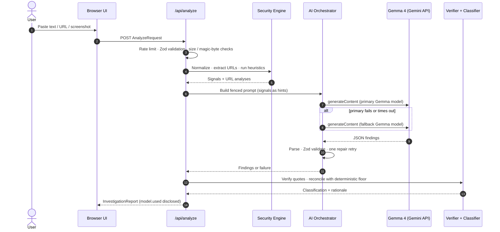
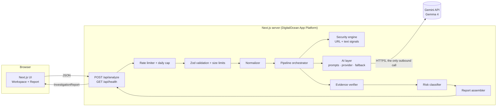

<div align="center">

# 🛡️ TrustLens AI

### Understand the Threat. Verify the Evidence. Stay Protected.

An open-source, evidence-based scam and phishing investigation platform powered by **Google Gemma 4**.


</div>

---

> ## ⚠️ Project status — please read
> TrustLens AI is being built for **Hacktoberfest Hack Day Chandigarh 2026** (submission deadline **27 Oct 2026, 16:30 IST**).
>
> **Today the repository contains the full engineering specification (`context/`) and a stock `create-next-app` scaffold. The investigation features described below are _designed, not yet implemented_.** This README marks every capability with a status badge, and the live status is tracked in [`context/Progress-tracker.md`](context/Progress-tracker.md). Nothing here is claimed as working, tested, or deployed until that tracker records execution evidence.
>
> | Marker | Meaning |
> |---|---|
> | 📐 **Specified** | Designed in the docs; no code yet |
> | 🚧 **In progress** | Being implemented |
> | ✅ **Verified** | Implemented and tested, with evidence in the tracker |
>
> As of this commit, nothing is marked ✅.

---

## Table of contents

1. [What is TrustLens?](#1-what-is-trustlens)
2. [Why it is different](#2-why-it-is-different)
3. [Features](#3-features)
4. [How an investigation works](#4-how-an-investigation-works)
5. [Evidence you can trust (and evidence you shouldn't)](#5-evidence-you-can-trust-and-evidence-you-shouldnt)
6. [Risk classification](#6-risk-classification)
7. [Architecture](#7-architecture)
8. [How Gemma 4 is used](#8-how-gemma-4-is-used)
9. [Technology stack](#9-technology-stack)
10. [Getting started](#10-getting-started)
11. [Configuration](#11-configuration)
12. [API reference](#12-api-reference)
13. [Project structure](#13-project-structure)
14. [Testing & evaluation](#14-testing--evaluation)
15. [Security model](#15-security-model)
16. [Privacy](#16-privacy)
17. [Deployment (DigitalOcean App Platform)](#17-deployment-digitalocean-app-platform)
18. [Limitations & honesty statement](#18-limitations--honesty-statement)
19. [Roadmap](#19-roadmap)
20. [Multi-agent development workflow](#20-multi-agent-development-workflow)
21. [Documentation map](#21-documentation-map)
22. [Contributing](#22-contributing)
23. [License](#23-license)
24. [Acknowledgements](#24-acknowledgements)

---

## 1. What is TrustLens?

Scams are increasingly personal: a WhatsApp "job offer", a bank-KYC SMS, a lookalike payment link, a screenshot of a "customer-care" chat. People need to know **why** something looks suspicious, not just a verdict.

TrustLens accepts suspicious content, investigates it with a combination of **deterministic security analysis** and **Gemma 4 multimodal reasoning**, and produces an **explainable report** that shows exactly what was found, how it was found, and what we could _not_ determine.

**Supported inputs**

| Input | Examples |
|---|---|
| 💬 Text | SMS, WhatsApp messages, emails, job offers, payment requests |
| 🔗 URL | Links from messages or ads (analyzed **structurally only, never opened**) |
| 🖼️ Screenshot | Chat screenshots, fake websites, payment screens (PNG / JPEG / WebP) |

**Every report contains** *(📐 Specified)*

1. Risk classification: **Low · Medium · High · Unknown**
2. Threat category (phishing, advance-fee, job scam, impersonation, …)
3. The exact suspicious phrases, highlighted in your message
4. URL and domain structural analysis
5. AI-generated contextual explanation
6. Manipulation techniques identified (urgency, fear, authority, …)
7. Recommended protective actions
8. English **and** Hindi (हिन्दी) explanations
9. Explicit limitations and uncertainty
10. Downloadable/printable report

TrustLens is **not** a chatbot, not a generic LLM wrapper, and **never** shows a made-up "87% scam" number.

---

## 2. Why it is different

| Typical "scam checker" | TrustLens |
|---|---|
| One opaque percentage | Ordinal label **plus** the rules that produced it |
| LLM output shown as-is | LLM output **validated against a schema** and every quoted phrase **verified to exist** in your input |
| Model can say anything | Model **cannot raise risk to High without a verified quote**, and **cannot lower risk below deterministic findings** |
| Fetches the link to "scan" it | **Never opens, resolves, or fetches** submitted URLs, which removes SSRF and avoids touching live malware |
| Silent model swaps | Report always states **which model actually ran**; fallback stays within Gemma 4, then degrades to rules-only, clearly labelled |
| English only | English **and** Hindi from one inference call |
| "Safe" badge | Low means *"no strong indicators found"*, never *"safe"* |

---

## 3. Features

| Feature | Priority | Status |
|---|---|---|
| Text investigation (SMS / WhatsApp / email) | P0 | 📐 Specified |
| URL structural forensics (host breakdown, registrable domain, signals) | P0 | 📐 Specified |
| Gemma 4 explanation, manipulation techniques, categories | P0 | 📐 Specified |
| Deterministic signals: IP-host, userinfo `@`, punycode/IDN, lookalike & brand-mismatch domains, deceptive subdomains, shorteners, encoding abuse | P0 | 📐 Specified |
| Text signals: urgency, threats, credential/OTP requests, advance-fee, remote-access requests, off-platform migration (EN / Hindi / Hinglish) | P0 | 📐 Specified |
| Evidence verification (quote must exist in input) | P0 | 📐 Specified |
| Explainable risk classification with rationale | P0 | 📐 Specified |
| English ⇄ Hindi switch | P0 | 📐 Specified |
| Evidence ↔ highlight linking in the message | P0 | 📐 Specified |
| Model disclosure & graceful degradation | P0 | 📐 Specified |
| Rate limiting, input limits, safe logging | P0 | 📐 Specified |
| Screenshot (multimodal) investigation with OCR caveats | P1 | 📐 Specified |
| Report export (JSON / Markdown / Print-to-PDF / copy) | P1 | 📐 Specified |
| Session history sidebar (in-memory) | P2 | 📐 Specified |
| Playwright end-to-end tests | P2 | 📐 Specified |

---

## 4. How an investigation works

```
User Input → Validation → Normalization → URL & Text Heuristics → Gemma 4 Inference
          → Response Validation → Evidence Verification → Risk Classification → Investigation Report
```



| Stage | What happens | If it fails |
|---|---|---|
| Validation | Zod schema, size limits, MIME and magic-byte checks | `400 / 413 / 415` |
| Normalization | Unicode NFKC, strips zero-width / bidi characters (and records that it did) | Never fails |
| Heuristics | Deterministic signals with bilingual explanations | Per-URL failure becomes an observation |
| Gemma inference | Fenced prompt, JSON output, timeout, fallback chain | Degrades to rules-only report |
| Response validation | Extract JSON → schema check → one repair retry | Treated as model failure |
| Evidence verification | Each quoted phrase is string-matched against the source | Unverified items are labelled and can't escalate risk |
| Classification | Pure deterministic function (§6) | Never throws |

---

## 5. Evidence you can trust (and evidence you shouldn't)

TrustLens refuses to blur the line between *what we saw* and *what a model thinks*.

| Class | Definition | Example | Can move risk? |
|---|---|---|---|
| **Observed** | A literal fact extracted by deterministic code | "The host is the IPv4 address `203.0.113.9`" | Via the signal it feeds |
| **Heuristic indicator** | A rule-based pattern that correlates with scams; **not proof** | "Urgency language: *within 24 hours*" | Yes, by weight |
| **AI interpretation** | Gemma's reading of context | "This imitates a bank KYC notice" | Only with a verified quote |
| **Independently verified fact** | Confirmed by an external authority | _None in the MVP_ | n/a |

> The MVP performs **no external lookups** (no WHOIS, no reputation feeds, no Safe Browsing, no fetching). It therefore does **not** claim any independently verified fact. Each evidence item carries a `quoteVerified` flag. That flag means "the quote exists in your input", **not** "the claim is true".

---

## 6. Risk classification

No probability. No confidence percentage. An **ordinal label plus a human-readable rationale**.

```
deterministicFloor:
  ≥2 distinct strong signals                 → HIGH
  1 strong + ≥1 weak                         → HIGH
  1 strong                                   → MEDIUM
  ≥2 weak                                    → MEDIUM
  1 weak                                     → LOW (with note)
  none                                       → NONE

aiEffective (if the model responded):
  AI high   + ≥1 verified quote              → HIGH
  AI high   + 0 verified quotes              → MEDIUM (capped, flagged as unsupported)
  AI medium + ≥1 verified quote              → MEDIUM, else LOW
  AI low                                     → LOW
  AI unknown                                 → NONE

final = max(deterministicFloor, aiEffective)
        UNKNOWN if input is insufficient, or if nothing was found AND AI is unavailable
```

Guarantees: the AI can **never lower** risk below deterministic findings · the AI can **never reach High** without a verified quote · prompt-injected "this is safe" claims have no effect when strong signals exist · "no indicators + AI down" is **Unknown**, not Low.

Full specification: [`context/Architecture.md` §6](context/Architecture.md).

---

## 7. Architecture



Design principles

- **Stateless**: no database, no stored submissions, exports happen client-side.
- **Deterministic first**: the rules engine runs before and independently of the model, so the product still works when AI is unavailable.
- **One outbound call**: only the Gemini API. Submitted URLs are never resolved or fetched.
- **Provider abstraction**: a single `AiProvider` interface; one file imports the Google SDK.
- **Contracts as code**: shared TypeScript types and Zod schemas are the single source of truth for UI and API.

Details, ADRs, and the threat model live in [`context/Architecture.md`](context/Architecture.md).

---

## 8. How Gemma 4 is used

| Aspect | Design | Verification status |
|---|---|---|
| Models | `gemma-4-31b-it` (primary) → `gemma-4-26b-a4b-it` (fallback) via the Gemini API | IDs are listed in Google's docs; **not yet called with our key** (task T0-01) |
| SDK | `@google/genai` | Documented; version to be pinned |
| Text analysis | System instruction + fenced untrusted content + deterministic signals as *hints* | 📐 Specified |
| Screenshot analysis | Image → OCR transcription (`extractedText`) + findings; OCR text is re-run through the deterministic engine and tagged `source: ocr` | Image transport (inline bytes vs Files API) **unverified** |
| Structured output | Prompted JSON → extract → Zod validate → one repair retry. Native JSON mode is **not** relied upon (not documented for Gemma) | Design decision (ADR-005) |
| Bilingual output | English and Hindi generated in the same call | Hindi quality to be reviewed in evals |
| Thinking | `minimal` by default for latency | To be tuned |
| Fallback | Gemma → Gemma → rules-only; the report discloses `requestedModel`, `usedModel`, every attempt, and `fellBack` | 📐 Specified |

**Prompt-injection defenses (layered):** per-request nonce fencing of untrusted content · the model has no tools or browsing · only schema-validated fields are consumed · text is rendered as React text nodes only · AI escalation requires verified quotes · injection attempts are surfaced as an indicator · an adversarial evaluation set guards regressions.

---

## 9. Technology stack

| Layer | Choice |
|---|---|
| Framework | Next.js (App Router), React, TypeScript (`strict`) |
| Styling / UI | Tailwind CSS, shadcn/ui, Lucide React, Motion (restrained) |
| Backend | Next.js Route Handlers, Zod, modular service architecture |
| AI | Google Gemma 4 through `@google/genai` |
| Security | WHATWG `URL`, [`tldts`](https://github.com/remusao/tldts) for registrable-domain analysis, curated heuristics |
| Testing | Vitest (unit + integration), opt-in live-model evals, Playwright (stretch) |
| Hosting | DigitalOcean App Platform via GitHub |

> The scaffold currently in the repo was generated by `create-next-app` and does not yet include the dependencies above. See task T0-02 in [`context/Plan.md`](context/Plan.md).

---

## 10. Getting started

### Prerequisites

- Node.js (developed on v26.0.0; the supported production range will be pinned in `engines`, task T6-01)
- npm
- A Google AI Studio API key with access to Gemma 4 models. **Access and quota are unverified until task T0-01 completes.**

### Run the current scaffold

```bash
git clone https://github.com/Aryan-en/Rein-Hacktoberfest-2026.git
cd Rein-Hacktoberfest-2026
npm install
npm run dev        # http://localhost:3000, currently the stock Next.js starter page
```

### Once the MVP lands 📐

```bash
cp .env.example .env.local     # then add GEMINI_API_KEY (never commit it)
npm run dev
npm run typecheck && npm run lint && npm test && npm run build
```

Planned scripts

| Script | Purpose |
|---|---|
| `npm run dev` / `build` / `start` | Standard Next.js lifecycle |
| `npm run typecheck` | `tsc --noEmit` under `strict` |
| `npm run lint` | ESLint |
| `npm test` | Unit + integration tests, **offline and deterministic** |
| `npm run test:ai` | Opt-in live-model evals (needs a key) |
| `npx tsx scripts/verify-model.ts` | Verifies Gemma endpoints, image transport, JSON behaviour |

---

## 11. Configuration

All configuration is environment-based and parsed with Zod at startup. Secrets are server-only (never `NEXT_PUBLIC_`).

| Variable | Required | Default | Description |
|---|---|---|---|
| `GEMINI_API_KEY` | For AI mode | none | Server-side secret. If absent the app runs rules-only and `/api/health` reports `missing_key` |
| `TRUSTLENS_PRIMARY_MODEL` | No | `gemma-4-31b-it` | First model to try |
| `TRUSTLENS_FALLBACK_MODEL` | No | `gemma-4-26b-a4b-it` | Second Gemma model |
| `TRUSTLENS_MODEL_TIMEOUT_MS` | No | `25000` | Per-attempt timeout |
| `TRUSTLENS_RATE_LIMIT_PER_MIN` | No | `10` | Per-client limit |
| `TRUSTLENS_DAILY_CAP` | No | `500` | Global daily inference cap |
| `TRUSTLENS_MAX_TEXT_CHARS` | No | `8000` | Text input limit |
| `TRUSTLENS_MAX_IMAGE_BYTES` | No | `4194304` | Image limit (4 MiB) |
| `LOG_LEVEL` | No | `info` | Log verbosity (never logs user content) |

---

## 12. API reference

### `POST /api/analyze` 📐

```jsonc
// Text
{ "inputType": "text",  "text": "SBI KYC expired! Update within 24 hrs: http://sbi-kyc-verify.example/login" }
// URL
{ "inputType": "url",   "url": "https://paypal.com.secure-login.example/verify" }
// Screenshot (≤ 4 MiB, PNG / JPEG / WebP, magic bytes verified)
{ "inputType": "image", "image": { "mimeType": "image/png", "dataBase64": "…" }, "note": "optional" }
```

Response: an `InvestigationReport` (classification, signals, URL analyses, evidence with provenance, techniques, bilingual explanation, recommendations, limitations, model disclosure, timings). The complete TypeScript contract is in [`context/Architecture.md` §7](context/Architecture.md).

| Status | Code | Meaning |
|---|---|---|
| 200 | | Report returned (also when degraded to `deterministic_only`) |
| 400 | `invalid_request` | Schema failure or empty input |
| 413 | `payload_too_large` | Body, text, or image over limit |
| 415 | `unsupported_media_type` | Wrong content type, disallowed or spoofed image type |
| 422 | `unreadable_image` | Image can't be decoded |
| 429 | `rate_limited` | Per-client or daily cap (`Retry-After` provided) |
| 503 | `service_unavailable` | Server misconfiguration |
| 500 | `internal_error` | Unexpected; generic message plus `requestId` |

A model failure is **not** an HTTP error. It yields a 200 report that says AI analysis was unavailable.

### `GET /api/health` 📐
Returns `{ status, version, ai: "configured" | "missing_key" }`. It does not call Gemma.

---

## 13. Project structure

**Target layout** (📐 Specified; the scaffold currently has the Next.js default `app/` at the repo root, and the layout will be reconciled in T0-02):

```
├── context/                 # Engineering docs: the source of truth
├── src/
│   ├── app/                 # Routes: landing, /investigate, /api/analyze, /api/health
│   ├── components/          # ui/ layout/ landing/ investigate/ report/ common/
│   ├── hooks/               # useInvestigation, useReportLanguage
│   ├── lib/
│   │   ├── security/        # normalize, URL & text heuristics, rate limit, image validation
│   │   ├── ai/              # provider adapter, prompts, orchestrator, parse, output schema
│   │   ├── analysis/        # pipeline, evidence verification, classification, recommendations
│   │   ├── validation/      # request/response Zod schemas, limits
│   │   ├── config/ report/ demo/ utils/
│   └── types/               # Shared contracts (InvestigationReport, ModelFindings, AiProvider)
├── tests/                   # unit/ integration/ ai/ e2e/
├── evals/  fixtures/        # Synthetic datasets, adversarial cases, results
├── scripts/                 # verify-model, smoke-inference, run-evals, smoke-live
└── .do/app.yaml             # DigitalOcean App Spec
```

---

## 14. Testing & evaluation

| Layer | Scope |
|---|---|
| Unit: security | Normalization, URL parsing, every signal with positive **and benign** cases (e.g. a genuine "never share your OTP" notice must not fire the credential-request signal) |
| Unit: analysis | Exhaustive truth table for classification, evidence verification, JSON repair, orchestrator with a fake provider |
| Integration: API | Status codes, schema conformance, rate limiting, degradation, **no outbound calls on URL input**, no content in logs |
| Live-model evals | Synthetic phishing / benign / adversarial / screenshot datasets; metrics: valid-JSON rate, quote-verification rate, risk in expected range, injection resistance; results committed with model ID and date |
| Security | Secret scans, CSP, oversized/spoofed uploads, injection corpus |
| Accessibility | Keyboard-only journeys, focus visibility, contrast, reduced motion |

All test data is **synthetic**. `npm test` makes **no network calls**.

**Current results:** no tests have been run. See [`context/Progress-tracker.md` §F](context/Progress-tracker.md).

---

## 15. Security model

| Threat | Mitigation |
|---|---|
| Prompt injection (text and image) | Nonce fencing, no model tools, schema-only consumption, verified-quote rule, deterministic floor, adversarial evals |
| SSRF | Submitted URLs are **never fetched or resolved**; only outbound call is the Gemini API |
| Malicious links | URLs rendered as inert, defanged text, never as anchors |
| Oversized / spoofed uploads | Byte caps before parsing, MIME allowlist, magic-byte check, no SVG, no server-side image decoding |
| Secret exposure | Server-only key, `.env*` ignored, generic error messages |
| Inference abuse | Per-client token bucket, global daily cap, body limits |
| Sensitive data | No persistence, no content logging, UI warns users to redact |
| Hallucination | Quote verification, deterministic recommendations, visible provenance labels |
| Misleading conclusions | Ordinal labels, "indicators not proof", Low ≠ safe, never accuses a named person or organisation |
| XSS | React text nodes only; no `dangerouslySetInnerHTML`; CSP |

Residual risks (per-instance in-memory rate limiting, model misinterpretation, third-party data handling) are listed in [`context/Architecture.md` §8](context/Architecture.md).

To report a vulnerability, open a private security advisory on the GitHub repository (or contact the maintainers); please don't post exploit details publicly.

---

## 16. Privacy

- TrustLens **does not store** submitted content: no database, no server-side files, no analytics.
- To analyse content, the server **sends it to Google's Gemini API**. Treat anything you submit as shared with that provider.
- **Retention and training terms of the Gemini API for your account tier have not been verified by this project.** They must be checked against Google's official terms before public launch (task T7-02).
- **Please redact** OTPs, passwords, card numbers, Aadhaar/PAN and other personal data before submitting.
- Logs contain only request IDs, input type, lengths, signal IDs, risk label, model IDs, latency, and error kinds.
- Fonts are self-hosted; no third-party trackers.

---

## 17. Deployment (DigitalOcean App Platform)

> 📐 Plan only. **Not deployed.** The live URL will be recorded in the tracker and below once verified.

| Item | Plan |
|---|---|
| Source | GitHub `main`, auto-deploy on push |
| Build / run | `npm ci && npm run build` / `npm start` |
| Health check | `GET /api/health` |
| Secrets | `GEMINI_API_KEY` as an encrypted env var in the console, never in the repo |
| Instance | Single smallest viable instance (in-memory rate limiter assumes one instance); check current pricing in the console |
| Verification | Scripted live smoke test: health, text, URL, 413, 400, 429 |
| Rollback | Redeploy the previous successful deployment, or `git revert` and push; known-good commit recorded before late deploys |

**Live demo:** _not yet available_

---

## 18. Limitations & honesty statement

TrustLens helps you **reason about** suspicious content. It is not an oracle.

1. It **doesn't open links** or contact senders, so it can't confirm what a site actually contains or who owns it.
2. Indicators are **patterns, not proof** of fraud. False positives and negatives are unavoidable.
3. **AI interpretation can be wrong** and is not independent verification.
4. **Low risk does not mean safe.**
5. Screenshot text is **machine-read** and may contain errors.
6. Brand coverage is a **small curated list** (India-focused plus global majors).
7. Hindi and Hinglish detection is lexicon-based and incomplete.
8. If you have lost money or shared credentials, **contact your bank and the official cybercrime reporting channel immediately**. Reporting channels shown in the app will be checked against official sources before release.

---

## 19. Roadmap

**MVP (hackathon):** text + URL investigation, bilingual reports, evidence linking, model disclosure, rate limiting, deployed demo.
**Stretch:** screenshot investigation, report export, Playwright E2E.
**Later (not committed):** reputation lookups with explicit user consent and clear provenance labels · more regional languages · browser extension · batch triage for helplines · expanded brand and lexicon datasets · community-contributed, reviewed test corpora.

---

## 20. Multi-agent development workflow

The project is built by three AI coding agents coordinated through repository files rather than shared runtime state:

| Agent | Role |
|---|---|
| **Claude** | Architecture, contracts, AI orchestration, risk logic, review, docs |
| **OpenAI Codex** | Next.js, UI, API routes, security utilities, adapter, build and deploy config |
| **Google Gemini** | Model verification, prompts, evals, adversarial testing, demo content |

Rules: exclusive file ownership, contract changes through one editor, mandatory handoff notes, evidence-based completion, and a time-based priority override toward the deadline. See [`context/AGENTS.md`](context/AGENTS.md). Status is only ever as true as the evidence in the tracker.

---

## 21. Documentation map

| Document | Purpose |
|---|---|
| [`context/AGENTS.md`](context/AGENTS.md) | Collaboration protocol, ownership, quality gates, security rules |
| [`context/Architecture.md`](context/Architecture.md) | System design, AI architecture, risk model, API contract, threat model, ADRs |
| [`context/Plan.md`](context/Plan.md) | Phased task plan with acceptance criteria and a time budget |
| [`context/Progress-tracker.md`](context/Progress-tracker.md) | Live status, logs, blockers, test evidence, deploy and submission checklists |
| [`context/UI-registery.md`](context/UI-registery.md) | Design system, page and component registry, UI↔API contracts |

---

## 22. Contributing

Contributions are welcome after the hackathon submission window. Until then, work follows the multi-agent protocol above.

1. Read [`context/AGENTS.md`](context/AGENTS.md) and the architecture doc.
2. Branch from `main` (`<name>/<topic>`), use Conventional Commits (`feat(security): …`).
3. Keep fixtures **synthetic**. Never include real victims' messages, numbers, or accounts.
4. Run `npm run typecheck && npm run lint && npm test && npm run build` before opening a PR.
5. Don't add network calls, telemetry, or dependencies without discussion.

---

## 23. License

**Not yet chosen.** The project is intended to be open source; a license (e.g. MIT or Apache-2.0) will be added by the maintainer before submission. Until a `LICENSE` file exists, all rights are reserved by default.

---

## 24. Acknowledgements

- [Google Gemma](https://ai.google.dev/gemma) open models and the Gemini API
- [Next.js](https://nextjs.org), [Tailwind CSS](https://tailwindcss.com), [shadcn/ui](https://ui.shadcn.com), [Lucide](https://lucide.dev), [Zod](https://zod.dev), [tldts](https://github.com/remusao/tldts), [Vitest](https://vitest.dev)
- Hacktoberfest Hack Day Chandigarh 2026 organisers

<div align="center">

**TrustLens AI**: built to help people pause, check the evidence, and stay protected.

</div>
